  
  
  
  

I study Computer Science and Engineering at CUET in Chattogram, Bangladesh, and
graduate in 2027. Half my time goes to building software and the other half to
research on explainable AI and NLP. I like problems where the engineering and
the reasoning both have to hold up: a model whose predictions you can defend, an
extension that keeps a promise about your privacy, a schema that stays correct
as it grows.

## Right now

- **Looking for** software engineering and ML roles: remote, or on site after I graduate in 2027.
- **Writing** my undergraduate thesis on grapheme-aware Bangla and English scene text recognition: reading text off photographs where Bangla and Latin script share a frame.
- **Just led** the five-person crawler team on my industrial attachment at [Cortex, BdREN Innovation](https://github.com/BdREN-Innovation/Cortex), 3 to 21 September 2026. I built the CUET scraper: 735 documents, 382 faculty profiles and 1,106 linked files, each traced back to its source.
- **Before that,** May to August 2026, I wrote 70+ evaluation tasks for agentic AI at Fleet AI, and reviewed other contributors' tasks before they shipped.

## Selected work

<table>
  <tr>
    <td width="50%" valign="top">
      
      <h3><a href="https://github.com/SamisDone/GreenLight-IUT-Techathon-Hackathon">Greenlight</a></h3>
      A robot arm you drive in the browser, six different ways, through one motion pipeline. I wrote the kinematics, the safety gate and every input path. Finalist at IUT Techathon 2026.  
      <code>Next.js</code> <code>Three.js</code> <code>TypeScript</code> <code>Gemini API</code>  
      <a href="https://greenlight-ptsd.vercel.app/">Live</a> · <a href="https://github.com/SamisDone/GreenLight-IUT-Techathon-Hackathon">Code</a> · <a href="https://samonwitasarker.pages.dev/work/greenlight">Case study</a>
    </td>
    <td width="50%" valign="top">
      
      <h3><a href="https://github.com/SamisDone/ResumeForge">ResumeForge</a></h3>
      A resume builder with a live preview and in-browser PDF export. No account, no upload.  
      <code>React</code> <code>Tailwind CSS</code> <code>React Router</code>  
      <a href="https://resumeforge-sam.netlify.app/">Live</a> · <a href="https://github.com/SamisDone/ResumeForge">Code</a> · <a href="https://samonwitasarker.pages.dev/work/resumeforge">Case study</a>
    </td>
  </tr>
  <tr>
    <td width="50%" valign="top">
      
      <h3><a href="https://github.com/SamisDone/Pierra">PIERRA</a></h3>
      Paid client work: a bilingual English and French site for a Montreal exterior design firm, delivered from brief to deployment.  
      <code>Next.js</code> <code>Tailwind CSS</code>  
      <a href="https://pierrafinal.vercel.app/">Live</a> · <a href="https://github.com/SamisDone/Pierra">Code</a> · <a href="https://samonwitasarker.pages.dev/work/pierra">Case study</a>
    </td>
    <td width="50%" valign="top">
      
      <h3><a href="https://github.com/SamisDone/AI-Powered-Hospital-Management-System">MediHub</a></h3>
      Hospital management with Gemini-written summaries of medical reports, and separate views for admins, doctors and patients.  
      <code>React</code> <code>Node.js</code> <code>Firebase</code> <code>Gemini API</code>  
      <a href="https://ai-powered-hospital-management-syst.vercel.app/">Live</a> · <a href="https://github.com/SamisDone/AI-Powered-Hospital-Management-System">Code</a> · <a href="https://samonwitasarker.pages.dev/work/medihub">Case study</a>
    </td>
  </tr>
  <tr>
    <td width="50%" valign="top">
      
      <h3><a href="https://github.com/SamisDone/RIPHours">RIPHours</a></h3>
      A Chrome extension that tracks your browsing time and makes no network requests, so your history stays on your machine. 500+ installs.  
      <code>JavaScript</code> <code>Chrome APIs</code>  
      <a href="https://chromewebstore.google.com/detail/riphours/iagjeekneaalapjnnofnifleaiondbbb">Chrome Web Store</a> · <a href="https://github.com/SamisDone/RIPHours">Code</a> · <a href="https://samonwitasarker.pages.dev/work/riphours">Case study</a>
    </td>
    <td width="50%" valign="top">
      
      <h3><a href="https://github.com/SamisDone/TabSaver-New">TabSaver</a></h3>
      A Chrome extension that saves and restores a whole working session, tab groups intact, in one click. 700+ installs.  
      <code>JavaScript</code> <code>Chrome APIs</code>  
      <a href="https://chromewebstore.google.com/detail/tabsaver/emjeegpjecaljggipjdaofmlkoolikdk">Chrome Web Store</a> · <a href="https://github.com/SamisDone/TabSaver-New">Code</a> · <a href="https://samonwitasarker.pages.dev/work/tabsaver">Case study</a>
    </td>
  </tr>
</table>

## Research

- **ACL 2026, first author.** [Still Loading@DravidianLangTech 2026: Telugu Prompt-Style Recovery using Multilingual Transformers](https://aclanthology.org/2026.dravidianlangtech-1.58/). Placed 7th in the shared task. [Code](https://github.com/Priyontee1713/Still-Loading-Prompt-Recovery-for-LLM-in-Telugu)
- **IEEE ICECTE 2026, peer reviewed.** [A Machine Learning and Explainable AI-Based Multiclass Police Fraud Prediction Scheme with SHAP Based Interpretability](https://ieeexplore.ieee.org/document/11429440). Every prediction comes with its SHAP attribution, so a flagged case traces back to the features that drove it.

## The portfolio

Built on one idea: every claim carries its receipt. Every number on it links to
whatever proves it, and every project picture is the real, running product.
[See it live](https://samonwitasarker.pages.dev) or
[read how it's made](https://github.com/SamisDone/Professional-Portfolio-SST).

## Toolbox

  
  
  
  
  
  
  
  
  
  
  
  
  
  

Away from the keyboard I'm President of the CUET MUN Club and Joint General
Secretary of the CUET Debating Society.

Every GIF above is a recording of the live project. All 27 projects, with source, are listed at <a href="https://samonwitasarker.pages.dev/repositories">samonwitasarker.pages.dev/repositories</a>.

