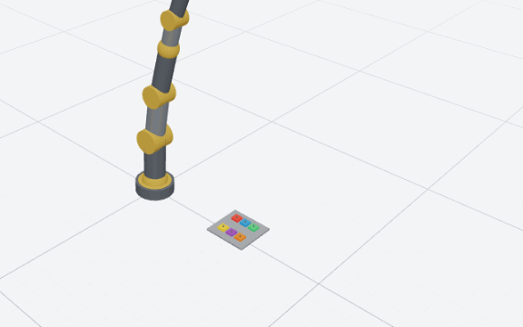
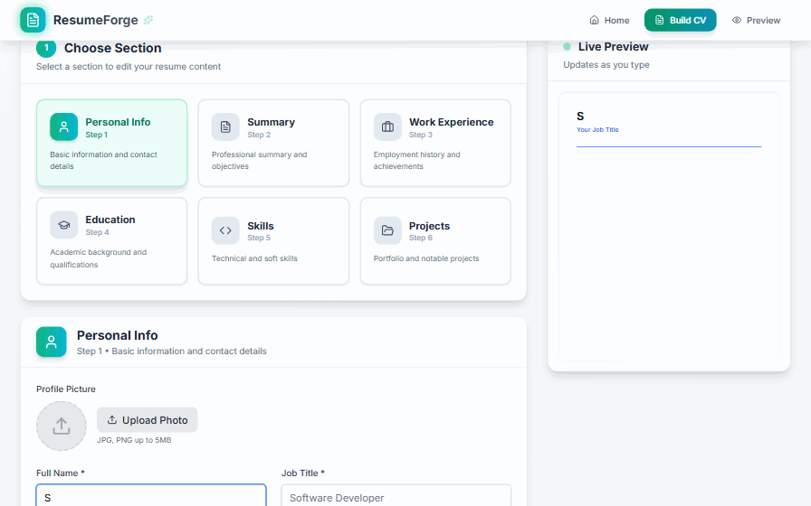
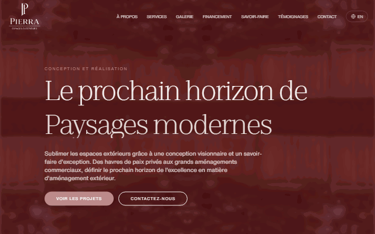
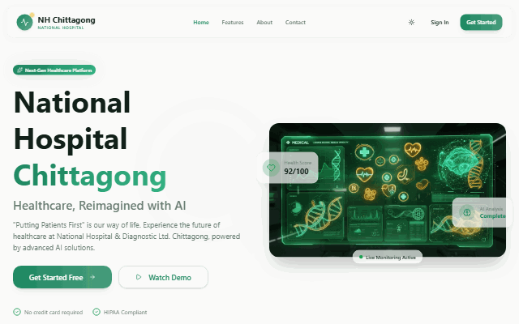
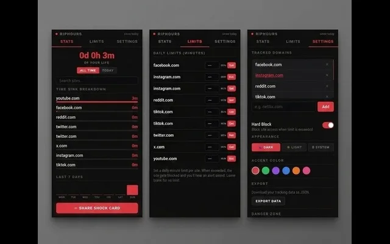
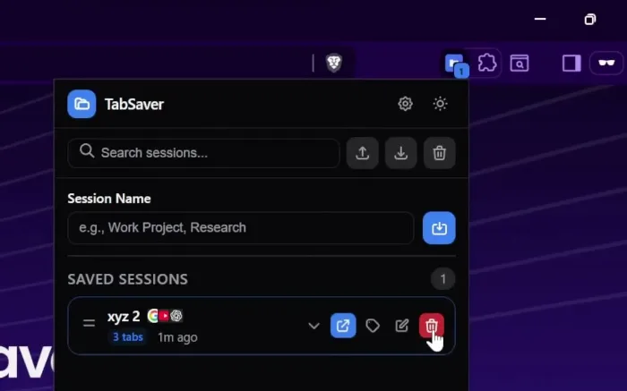

  
  
  
  

## Right now

- **Looking for** job opportunities in software engineering and ML: remote, or on site after I graduate in 2027.
- **Doing** my industrial attachment at BdREN Innovation - Cortex, 3 to 23 September 2026.
- **Writing** my undergraduate thesis on grapheme-aware Bangla and English scene text recognition.
- **Just finished** a contract at Fleet AI, writing and reviewing long-horizon evaluation tasks for AI agents.

## Selected work

<table>
  <tr>
    <td width="50%" valign="top">
      
      <h3><a href="https://github.com/SamisDone/GreenLight-IUT-Techathon-Hackathon">Greenlight</a></h3>
      A robot arm you drive in the browser, six different ways, through one motion pipeline. I wrote the kinematics, the safety gate and every input path.  
      <code>Next.js</code> <code>Three.js</code> <code>TypeScript</code> <code>Gemini API</code>  
      <a href="https://greenlight-ptsd.vercel.app/">Live</a> · <a href="https://github.com/SamisDone/GreenLight-IUT-Techathon-Hackathon">Code</a> · <a href="https://samonwita.vercel.app/work#greenlight">Case study</a>
    </td>
    <td width="50%" valign="top">
      
      <h3><a href="https://github.com/SamisDone/ResumeForge">ResumeForge</a></h3>
      A resume builder with a live preview and in-browser PDF export. No account, no upload.  
      <code>React</code> <code>Tailwind CSS</code> <code>React Router</code>  
      <a href="https://resumeforge-sam.netlify.app/">Live</a> · <a href="https://github.com/SamisDone/ResumeForge">Code</a> · <a href="https://samonwita.vercel.app/work#resumeforge">Case study</a>
    </td>
  </tr>
  <tr>
    <td width="50%" valign="top">
      
      <h3><a href="https://github.com/SamisDone/Pierra">PIERRA</a></h3>
      Paid client work: a bilingual English and French site for a Montreal exterior design firm, delivered from brief to deployment.  
      <code>Next.js</code> <code>Tailwind CSS</code>  
      <a href="https://pierrafinal.vercel.app/">Live</a> · <a href="https://github.com/SamisDone/Pierra">Code</a> · <a href="https://samonwita.vercel.app/work#pierra">Case study</a>
    </td>
    <td width="50%" valign="top">
      
      <h3><a href="https://github.com/SamisDone/AI-Powered-Hospital-Management-System">MediHub</a></h3>
      Hospital management with Gemini-written summaries of medical reports, and separate views for admins, doctors and patients.  
      <code>React</code> <code>Node.js</code> <code>Firebase</code> <code>Gemini API</code>  
      <a href="https://ai-powered-hospital-management-syst.vercel.app/">Live</a> · <a href="https://github.com/SamisDone/AI-Powered-Hospital-Management-System">Code</a> · <a href="https://samonwita.vercel.app/work#medihub">Case study</a>
    </td>
  </tr>
  <tr>
    <td width="50%" valign="top">
      
      <h3><a href="https://github.com/SamisDone/RIPHours">RIPHours</a></h3>
      A Chrome extension that tracks your browsing time and makes no network requests, so your history stays on your machine.  
      <code>JavaScript</code> <code>Chrome APIs</code>  
      <a href="https://chromewebstore.google.com/detail/riphours/iagjeekneaalapjnnofnifleaiondbbb">Chrome Web Store</a> · <a href="https://github.com/SamisDone/RIPHours">Code</a>
    </td>
    <td width="50%" valign="top">
      
      <h3><a href="https://github.com/SamisDone/TabSaver-New">TabSaver</a></h3>
      A Chrome extension that saves and restores a whole working session, tab groups intact, in one click.  
      <code>JavaScript</code> <code>Chrome APIs</code>  
      <a href="https://chromewebstore.google.com/detail/tabsaver/emjeegpjecaljggipjdaofmlkoolikdk">Chrome Web Store</a> · <a href="https://github.com/SamisDone/TabSaver-New">Code</a>
    </td>
  </tr>
</table>

## Research

- **ACL 2026, first author.** [Still Loading@DravidianLangTech 2026: Telugu Prompt-Style Recovery using Multilingual Transformers](https://aclanthology.org/2026.dravidianlangtech-1.58/). Placed 7th in the shared task. [Code](https://github.com/Priyontee1713/Still-Loading-Prompt-Recovery-for-LLM-in-Telugu)
- **IEEE ICECTE 2026.** [A Machine Learning and Explainable AI-Based Multiclass Police Fraud Prediction Scheme with SHAP Based Interpretability](https://ieeexplore.ieee.org/document/11429440)

## Toolbox

  
  
  
  
  
  
  
  
  
  
  
  
  
  

Every GIF above is a recording of the live project. All 25 projects, with source, are listed at <a href="https://samonwita.vercel.app/repositories">samonwita.vercel.app/repositories</a>.

